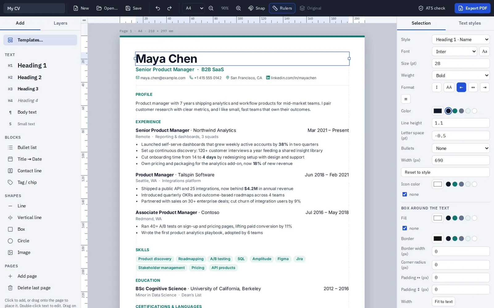

# CV Editor

A browser-based document editor with editable PDF import, reusable text styles, ATS text inspection, and Hebrew/English layout support.

[Portfolio case study](https://vadim-kravets.vercel.app/work/cv-editor/) · [Vadim Kravets](https://vadim-kravets.vercel.app/)



## My role

Product direction, problem framing, scope, design decisions, and review. AI coding agents wrote implementation code and tests under my direction. This is an independent portfolio project.

## What to explore

- PDF import, editing, and PDF export
- Document templates, reading-order checks, and local autosave
- Optional translation using the visitor's own key, from a local file only

## Try it locally

```sh
node --test tests/*.test.mjs
```

Open index.html locally to try the editor. The starter documents contain fictional example identities. PDF editing needs no API key. Translation is optional and requires your own provider key.

## About this public copy

This is a curated showcase snapshot with fresh Git history. It contains no production credentials, private project-session records, owner databases, or connection to the private working repository. Changes to this copy do not deploy or modify the working app. It has no inherited deployment integration, repository secrets, or paid Actions workflow.

The code can be reviewed and run locally. Forks and proposed changes do not grant write access to the original app. Public source is not a guarantee that software has no bugs.

[Usage and architecture reference](GUIDE.md) · [Publication checks](PUBLICATION.md)

## License and third-party material

Source is shared for portfolio review; no additional open-source license is granted for my original code. Bundled libraries, fonts, and documentation retain their respective licenses and notices.
